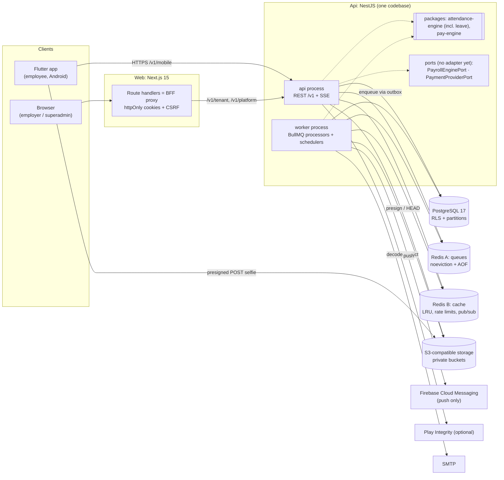
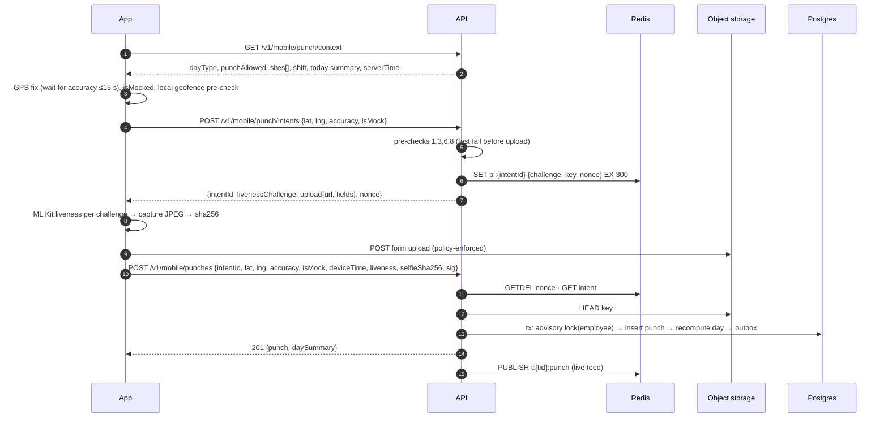

# Attendance + Pay Monitoring SaaS: Architecture

> v1.1 · 2026-10-27 · Status: proposed · Companion: `database-schema.md`
> Fixed stack: NestJS + PostgreSQL + Prisma + Redis + BullMQ + S3-compatible storage (Api) · Next.js 15 App Router + MUI 6 + TanStack Query + axios (Web) · Flutter, Android first (App). Hosted in India, Docker, provider-portable.

## 1. Principles
- **Modular monolith.** One NestJS codebase, two processes (`api`, `worker`). Split only when measurements justify it.
- **Tenant isolation in depth.** CLS context → Prisma extension → Postgres RLS → composite tenant FKs → automated cross-tenant tests.
- **Server is authoritative** for time, geofence, which day a punch belongs to, hours and earned pay. Client-side checks are for UX only.
- **Pure engines.** Attendance, leave and pay calculations live in `packages/*-engine`: no IO, deterministic, versioned, golden-tested.
- **Pay tiers.** BASIC ("pay monitoring") is built now. FULL (statutory suite) is deferred behind `PayrollEnginePort`.
- **Billing.** Collection is manual now, behind `PaymentProviderPort`.
- **Optional modules through a feature registry**, each either tenant-managed or platform-managed (§6).
- **Evidence is append-only.** Punches, manual marks, leave ledger, pay adjustments, audit, consent.
- **Portable.** Docker, Postgres, Redis, S3 API, SMTP. External services: FCM (push only, free) and Play Integrity (optional). **No SMS/OTP cost**: employees activate with an employer-issued code.

## 2. Component diagram



## 3. Monorepo layout

```
D:\attendance\
├─ Backend/                          NestJS 11 (pnpm workspace "backend")
│  ├─ prisma/  schema.prisma · migrations/ (Prisma + hand SQL: RLS, partitions, triggers, grants) · seed/ (holiday templates, plans)
│  ├─ src/  main.ts (HTTP) · worker.ts (BullMQ) · app.module.ts · worker.module.ts
│  │  ├─ core/      config · context · database · redis · queue · storage · crypto · auth · rbac · features
│  │  │             audit · throttle · notifications · integrity · http · observability · ports
│  │  └─ modules/<domain>/  *.module.ts · *.controller.ts · *.service.ts · *.repository.ts · *.processor.ts · *.spec.ts
│  └─ test/  e2e/ · isolation/ (cross-tenant suite) · fixtures/
├─ Web/                          Next.js 15, TypeScript
├─ App/                          Flutter (outside pnpm)
├─ packages/
│  ├─ contracts/          Zod DTO schemas + types, error codes, permission modules, feature registry, PayrollPeriodInput contract
│  ├─ attendance-engine/  pure: shift attribution, computeDay, summarizePeriod, leave/ (day counting, accrual math)
│  ├─ pay-engine/         pure: divisor resolution, segment split, computePaySummary, MTD/projection, golden fixtures
│  └─ config/             tsconfig, eslint (bans: PlatformDb outside allow-list, $queryRawUnsafe)
├─ infra/   docker-compose.yml (postgres 17, redis ×2, minio, mailpit) · docker/ · deploy/
├─ docs/    architecture.md · database-schema.md · adr/
└─ pnpm-workspace.yaml · turbo.json · package.json
```

Inherited conventions:
- **Web** follows the CRM BFF pattern: route handlers proxy to the API with httpOnly cookies + CSRF. Here it is a **single catch-all proxy** rather than per-domain routes, and it is TypeScript so it can share `packages/contracts`.
- **App** mirrors CRM-App: `app/`, `core/{config,network,auth,storage,permissions,notifications,lifecycle,ui}`, `core/providers.dart`, `features/<x>/data|presentation`, `shared/widgets`, `theme/`.

## 4. Runtime and deployment

| Container / service | Role | Notes |
|---|---|---|
| `web` | Next standalone: UI + BFF | ≥2 replicas, stateless |
| `api` | REST + SSE | ≥2, HPA on CPU/RPS |
| `worker` | BullMQ processors + job schedulers | ≥2; heavy queues (exports, media) can run as separate deployments of the same image |
| `migrate` | one-shot `prisma migrate deploy` | per release; expand → migrate → contract |
| Postgres 17 | managed, PITR, India region, PgBouncer (transaction mode) | read replica later for reports |
| Redis A | queues: `noeviction`, AOF (BullMQ requirement) | never shared with cache |
| Redis B | cache, nonces, rate limits, pub/sub: `allkeys-lru` | |
| Object storage | S3 API with presigned **POST** support (AWS S3, MinIO, most S3-compatibles) | media bucket **versioning off** so purges are real |

Environments: dev (compose + MinIO + Mailpit), staging, prod.

## 5. Tenancy enforcement (decision)

Shared DB with `tenant_id` on every tenant-owned row, enforced at four layers:
1. **Context.** `nestjs-cls` holds `{tenantId, realm, actor, scope, features}`. It is set only by the auth guard, from the verified JWT (never from a header, body or path). Workers: the processor base class sets CLS from job payload `tenantId`, and rejects payloads without one.
2. **Prisma client extension** on `TenantDb` (`$extends({ query: { $allModels: { $allOperations } } })`). The set of models with `tenantId` is derived from the Prisma DMMF at boot, so there is no hand-kept list. The extension injects `tenantId` into `where` and `data` (including createMany/upsert) and throws `TenantContextMissing` when there is no context. The deprecated `$use` middleware is not used.
3. **Postgres RLS.** Every tenant table has `ENABLE` + `FORCE ROW LEVEL SECURITY`, policy `tenant_id = app_current_tenant()`.
   - `TenantDb` runs each operation as `$transaction([set_config('app.tenant_id', tid, true), op])`.
   - Interactive work goes through `db.tx(fn)`, which sets the config first.
   - The setting is transaction-local, so it is safe with PgBouncer transaction pooling.
4. **Composite FKs** `(tenant_id, x_id) → x(tenant_id, id)` make cross-tenant references impossible, even from buggy raw SQL.

DB roles:
- `app_owner`: migrations.
- `app_tenant`: API and worker tenant work. RLS enforced; INSERT-only on append-only tables.
- `app_platform`: BYPASSRLS. Used by superadmin, billing, scheduler fan-out and the auth lookup.
- `PlatformDb` may only be imported from allow-listed modules (ESLint rule).
- The only cross-tenant read on the employee path is `ActivationLookupRepository.findLiveEmployeeByPhone()`. Phone is globally unique among live employees, so it returns at most one tenant + employee.

Why both layers 2 and 3: the extension gives ergonomics and early, clear errors; RLS is the backstop for raw SQL, nested writes and future mistakes. Cost: one extra statement per operation (~0.3–1 ms), which we accept.

Rejected:
- Schema-per-tenant: migration fan-out and connection-pool bloat.
- DB-per-tenant: ops cost at thousands of tenants.

## 6. Tenant settings and feature model

- **`tenant_settings`** (typed, always present, tenant-editable):
  - timezone (default Asia/Kolkata), selfie retention, activation-code TTL
  - geofence defaults (radius, max accuracy, accuracy buffer cap)
  - **pay divisor** (CALENDAR_DAYS | FIXED_26 | WORKING_DAYS), pay rounding, week start
  - **`show_earnings_in_app` (default false)**
  - MFA policy
- **`tenant_features`**: one row per (tenant, feature_key) with `{enabled, config jsonb, managed_by}`.
  - The registry lives in `packages/contracts/features.ts`: key, default, `requires`, `managedBy` (TENANT | PLATFORM), Zod config schema.
  - Platform-managed rows are writable only by `app_platform`; an RLS WITH CHECK enforces this.
  - **Effective = (tenant row ?? plan default ?? registry default) ∧ dependencies enabled.**

| Feature key | Managed by | Default | Config |
|---|---|---|---|
| PAYROLL | PLATFORM (superadmin, per plan) | on, `{tier: "BASIC"}` | `tier: BASIC \| FULL`. FULL is listed in the registry but `available: false` until built; the console disables it |
| LEAVE | TENANT | off | `year_start_month` (1), backdate/advance limits |
| OVERTIME | TENANT | off | none (rule details in attendance_policies) |
| EXTRA_TIME | TENANT | on | none (gates the regularization routes, web and app) |
| LIVE_MAP | TENANT | on | none (gates `dashboard/map`) |
| PAY_MONITORING | TENANT | on | none (gates `/tenant/pay/*` and the salary-register export) |
| EXPORTS | TENANT | on | none (gates `/tenant/exports/*`) |
| BULK_IMPORT | TENANT | on | none (gates `/tenant/employee-imports/*`) |
| DEVICE_APPROVAL | TENANT | off | none (approvers = permission DEVICES.edit) |
| AUTO_EMAIL_ACTIVATION_CODES | TENANT | off | none |
| EMPLOYEE_EARNINGS_VIEW | TENANT | off | requires PAY_MONITORING |

- **Platform control.** Every feature is a MODULE (a whole area) or an OPTION (behaviour of an area). The console sets any feature per client with
  `PUT /v1/platform/tenants/:id/features {key, enabled, locked}`; `locked` (`tenant_features.locked_by_platform`) stops the client's Admin from
  changing it (`FEATURE_LOCKED`). Both sides read `{…definition, enabled, locked}` from `GET …/features`.
- **Branding.** `tenants.branding` (jsonb: `primaryColor`, `accentColor`, `logoUrl`) is set from the console with `PUT /v1/platform/tenants/:id/branding`
  and returned, defaults filled in, by `/tenant/me` (`tenant.branding`) and `/mobile/me` (`company.branding`). The web dashboard and the app theme from it.

- **Enforcement.**
  - `@RequireFeature(F.LEAVE)` guard returns 404 `FEATURE_DISABLED`; `@RequirePayTier('BASIC')` guards pay routes.
  - Engines receive resolved features and settings as input (they are part of `inputs_hash`).
  - `/tenant/me` and `/mobile/me` return effective features, and the UI/app hides tabs.
- **Changes.**
  - Audited (`tenant.feature.update`, `tenant.settings.update`); bump `tenant_settings.features_version` (cache key).
  - OVERTIME change triggers recompute of open days. A divisor change triggers recompute of OPEN pay summaries.
  - Turning a feature off keeps its data and blocks new writes.

## 7. Auth and sessions (three actor types)

| | Employee (app) | Tenant user: Admin/Manager (web) | Platform user: Superadmin (console) |
|---|---|---|---|
| Identity | `employees.phone_e164`, globally unique among INVITED/ACTIVE → exactly one tenant | `users` (global email) → `tenant_memberships` (company picker if >1) | `platform_users` |
| First proof | phone + **employer-issued activation code** (§8) | email + password (argon2id) + TOTP (tenant can mandate for Admins) | email + password + TOTP mandatory; optional IP allowlist |
| Possession | P-256 key in Android Keystore bound to `device_bindings` | none | none |
| Unlock | local PIN or biometric (local_auth) | none | none |
| Access JWT (EdDSA) | 15 min, `aud=emp`, `{sub, tid, bid, sv}` | 15 min, `aud=tenant`, `{sub=membership, uid, tid, rid, pv, act?}` | 10 min, `aud=platform`, `{sub, prole}` |
| Refresh | opaque, rotating, 90 d sliding, **PoP-signed** | opaque, rotating, 14 d sliding / 30 d absolute | 12 h absolute |
| Storage | refresh: flutter_secure_storage; access: memory; private key non-exportable | `__Host-t_at` / `__Host-t_rt` httpOnly Secure SameSite=Lax on employer host, set by BFF | `__Host-p_at` / `__Host-p_rt` on console host |
| Logout | none (employer releases device) | yes (revokes family) | yes |

Common rules:
- **Realm separation.** Each realm has its own signing key (`kid`, rotation), and guards check `aud`, so a token from one realm is useless in another.
- **Refresh rotation with reuse detection.** A reused token revokes the whole family and is audited as `auth.refresh_reuse`.
- **Per-request checks, cached in Redis:**
  - Binding ACTIVE (`bind:{bid}`). Release deletes the key, so cut-off is immediate.
  - Membership `pv` equals the current permission version; otherwise 401 `PERMISSIONS_CHANGED` and the BFF refreshes.
  - Tenant status.
- **Web accounts.** Login lockout after 10 failures (30 min). Password reset by email link (token hash, 30 min TTL).
- **Impersonation**, step by step:
  1. Superadmin calls `POST /v1/platform/tenants/:id/impersonations {reason, ticketRef, mode}`. READ_ONLY is the default; READ_WRITE needs the SUPERADMIN role + a second confirm.
  2. API creates an `impersonation_sessions` row (30 min) and a one-time code.
  3. Console redirects to the employer host at `/api/auth/tenant/impersonate?code=`.
  4. BFF exchanges the code for a tenant-realm token with `act: {sub: platformUserId, sid}`.
  5. READ_ONLY blocks non-GET calls. Every request is audited as `impersonation.request`. The UI shows a red banner, the session appears in the tenant's audit log, and impersonation is refused if `tenants.support_access_allowed = false`.

## 8. Employee activation and device binding

### 8.1 Activation codes
- **Issued on:**
  - Employee create (single): returned once in the response; the web modal shows the code, a QR (code only) and a printable card.
  - "Regenerate": confirm dialog; revokes the previous code.
  - "Release device": automatic; revokes the binding and issues a new code.
  - Bulk "Issue & download": streams XLSX (name, phone, code) directly in the HTTP response, never stored. It re-issues codes for the selection, so the UI warns that old codes stop working.
  - Auto-email job (feature AUTO_EMAIL_ACTIVATION_CODES + employee has email): the code is generated inside the job and exists only in memory and in the email.
- **Format.** 8 chars from `ABCDEFGHJKLMNPQRSTUVWXYZ23456789` (32 symbols, ~40 bits), CSPRNG (`crypto.randomInt`). Displayed `ABCD-EFGH`; input is uppercased and stripped of `-`/spaces.
- **Storage.** `HMAC-SHA256(pepper_vN, tenant_id|employee_id|purpose|code)` + `pepper_version`. Plaintext is never persisted, logged, queued or audited. Including employee_id in the HMAC stops cross-employee reuse.
- **Lifetime.** Single use. Expiry `tenant_settings.activation_code_ttl_days` (default 7, range 1–30). One live code per (employee, purpose).
- **Purposes.** `ACTIVATION` binds a new device. `PIN_RESET` unlocks an existing binding after a forgotten PIN.
- **"View".** Plaintext is visible only at issuance. Viewing later means regenerating (see Q2).
- **Brute force:**
  - 5 failed attempts per phone → code `LOCKED`; the employer must reissue.
  - Unknown phones get an identical Redis counter (`act:fail:{hmac(phone)}`, 24 h), so behaviour never reveals whether a phone exists.
  - 10 per 15 min per IP; 5 per 15 min per install_id.
  - Constant-time compare; a dummy HMAC is computed when no employee matches.
  - One generic error, `ACTIVATION_FAILED` ("Check phone and code, or contact your employer"), covers: unknown phone, wrong/expired/used/locked code, inactive employee, suspended tenant, existing binding.
- **Phone prefill.** Android Phone Number Hint API (`GetPhoneNumberHintIntent`), UX only, not proof.

### 8.2 Device key
- **Key.** EC P-256 (`ES256`) in AndroidKeyStore, alias `attn_device_v1`, non-exportable. StrongBox if present, else TEE. Attestation challenge = server nonce.
- **Plugin.** Kotlin MethodChannel `DeviceSecurityPlugin`: generateKey, sign, attestationChain, androidId, integrityToken, phoneNumberHint.
- **Attestation check.** Server verifies the chain against configurable Google roots, parses the KeyDescription extension (OID 1.3.6.1.4.1.11129.2.1.17, `@peculiar/asn1-android`), and checks the challenge. It records the security level; SOFTWARE keys are allowed but flagged.
- **Play Integrity.** Optional (`tenant_settings.require_play_integrity`). The verdict is decoded server-side.
- **Proof of possession (PoP).**
  - Used on refresh, punch commit, binding-status poll and PIN reset; not on every request.
  - Message: `v1|<purpose>|<nonce>|<sha256(canonical JSON body)>`.
  - Nonce from `POST /mobile/auth/nonce`: Redis, 120 s, single-use GETDEL.

### 8.3 Activation sequence

```mermaid
sequenceDiagram
  autonumber
  actor Emp as Employee
  participant A as App
  participant K as Keystore
  participant S as API
  participant W as Employer web
  W->>S: create employee / regenerate / release device
  S-->>W: code (plaintext once) → QR card / XLSX / email
  W-->>Emp: hand over code
  Emp->>A: phone (Number Hint prefill) + code (typed or QR scan)
  A->>S: POST /v1/mobile/auth/nonce
  S-->>A: nonce
  A->>K: generateKey(P-256, attestationChallenge = nonce)
  K-->>A: publicKey + attestation chain
  A->>S: POST /v1/mobile/auth/activate {phone, code, publicKey, attestation, installId, deviceInfo, fcmToken, sig(nonce)}
  S->>S: rate limits → phone → live employee → code HMAC → no PENDING/ACTIVE binding → attestation + sig
  alt DEVICE_APPROVAL off
    S->>S: tx: binding ACTIVE, code USED, employee INVITED→ACTIVE, audit
    S-->>A: 200 {accessToken, refreshToken, employee, features, consentRequired}
  else DEVICE_APPROVAL on
    S->>S: tx: binding PENDING, code USED, audit device.binding.pending
    S-->>A: 202 {bindingId, livenessChallenge, selfieUpload (presigned POST)}
    A->>A: liveness + selfie → upload
    A->>S: POST /v1/mobile/auth/bindings/{id}/selfie {sha256, liveness, sig}
    S->>W: notify approvers (selfie, model, "same phone as previous binding")
    W->>S: approve / reject (reason)
    S-->>A: FCM "approved"; app POST /bindings/{id}/status {nonce, sig} → tokens
  end
  A->>Emp: set PIN or enable biometric → consent → home
```

### 8.4 Binding lifecycle (status PENDING → ACTIVE → REVOKED)

| Situation | Behaviour |
|---|---|
| First activation | as sequence. One binding per employee among PENDING/ACTIVE (partial unique index) |
| Approver rejects | binding REVOKED (`REJECTED`); employer regenerates code if desired |
| Reinstall / app data cleared / factory reset / new phone | key lost, so app is back at activation. Employer clicks **Release device**: old binding REVOKED, refresh family revoked, Redis `bind:{bid}` deleted, **new ACTIVATION code auto-issued**. Employee activates. No self-rebind |
| Lost / stolen phone | same Release. Cut-off is immediate on the next request |
| Forgot PIN, or 5 wrong PINs | app locks; biometric (if enrolled) can still unlock and change PIN. Otherwise employer issues **PIN_RESET** code. App `POST /v1/mobile/auth/pin-reset {code, nonce, sig}` signed by the ACTIVE binding's key. Binding unchanged; app sets new PIN. Reason: PIN is local, but reset needs the employer so a thief cannot reset it locally |
| Employee DEACTIVATED / EXITED | bindings REVOKED, codes REVOKED, tokens revoked, **phone released** for reuse |
| Approval queue | approver sees activation selfie, device model/OS, key security level, integrity verdict, "same phone as previous binding" (`android_id_hmac` match) |

Audit events: `activation_code.issued|regenerated|bulk_issued|emailed|locked|revoked`, `auth.activation.succeeded`, `device.binding.pending|approved|rejected|released|revoked`, `auth.pin_reset.code_issued|succeeded`. Failures go to metrics only; code values are never audited.

### 8.5 App lock
- **PIN:** 6 digits, hashed with PBKDF2-HMAC-SHA256 (≥100k iterations) + salt in flutter_secure_storage.
- **Biometric:** `local_auth` with BIOMETRIC_STRONG.
- **When it locks:** cold start, and after 5 min in background (CRM `background_return.dart` pattern).
- **No logout button.** Profile shows: "This phone is registered to you. To use another phone, ask your employer to release it."

## 9. Punch flow

**Decision: presigned POST, direct to storage.**
- Policy pins the exact key, `Content-Type=image/jpeg`, `content-length-range` 20 KB–600 KB, 120 s expiry.
- Why: the API never carries image bytes (~60 GB/day at 400k punches), and a POST policy (unlike presigned PUT) enforces size.
- Cost: three calls and an orphan sweep.
- Rejected: multipart upload through the API.



Commit validation order. The first failure rejects, writes `punch_rejections`, and returns a stable error code:
1. **Auth.** `aud=emp`; binding ACTIVE; tenant not SUSPENDED/CANCELLED; employee ACTIVE.
2. **Intent and signature.** Intent belongs to this employee and is unconsumed. Nonce valid. Signature valid (binding key) over the canonical payload, including the selfie sha256.
3. **Rate.** Gap ≥ policy `min_punch_gap_sec` (60); ≤100 per day.
4. **Selfie.** Object exists; type and size OK.
5. **Liveness.** `passed`; steps equal the **server-issued random challenge** (stops canned replays); duration 1–20 s; exactly one face.
6. **Location.**
   - `isMock` false (policy `block_mock_location`, default true).
   - `accuracy_m ≤ site.max_accuracy_m`.
   - Inside if, for some allowed site, `haversine(p, site) ≤ radius_m + min(accuracy_m, accuracy_buffer_cap_m)`. Allowed sites: `ASSIGNED_SITES` = employee_sites; `ANY_TENANT_SITE` = all active sites.
   - Otherwise `OUTSIDE_GEOFENCE`, with nearest site + distance for UX.
7. **Attribution.** Server `now()` → shift instance → `attendance_date` (§10).
8. **Day gate.** Precedence: override > approved full-day leave (`ON_LEAVE`) > holiday (branch calendar) > weekly off (employee pattern ?? branch pattern) > working. A non-working day without an override with `allow_punch` → `NON_WORKING_DAY`.
9. **Persist.** One tx with `pg_advisory_xact_lock(tenant, employee)`: idempotency check (punch id = intent id), insert punch with `sequence_no`, synchronous day recompute, outbox `punch.created` (+ `pay.recompute` if the day's pay inputs changed).
10. **After commit.** Pub/sub to live feed. Outbox → `selfie-postprocess`: 160 px thumbnail; sha256 check, where a mismatch adds the `SELFIE_HASH_MISMATCH` flag.

Other rules:
- No offline punching: the button is disabled when offline. Intent TTL of 5 min covers retries on a flaky network.
- Clock skew >5 min is flagged, not rejected.
- No gallery path (no image_picker).

**On-device liveness:**
- Front-camera image stream → `google_mlkit_face_detection` (classification + tracking).
- Challenge = 2 random steps from: blink (eye-open probability <0.2 then >0.8), turn left/right (|Euler Y| >20°), smile (>0.7).
- Exactly one face, face box ≥35% of frame width.
- Final frame front-facing (|Y| <10°), resized to 720 px long edge, JPEG q80, EXIF stripped.

## 10. Attendance hours engine (`packages/attendance-engine`)

**Shift instance and attribution**
- A shift has local `start_time`/`end_time`, `duty_minutes`, `unpaid_break_minutes`, `window_before_start_min` (120), `window_after_end_min` (360), and `is_flexible`. It is overnight when end ≤ start.
- Instance for date D: start = D + start_time in tenant TZ, converted to UTC; end = start + span. Attribution window = [start − before, end + after].
- A punch goes to the instance whose window contains it. If windows overlap, pick the latest start ≤ punch time. If none contains it, use the tenant-local calendar date and flag `OUT_OF_SHIFT_WINDOW`.
- **Overnight:** a 05:50 Tuesday punch on a 22:00–06:00 shift belongs to Monday.
- No shift: implicit 00:00–24:00 local day.
- Storage is UTC; `attendance_date` is a `date` in tenant TZ.

**`computeDay(input) → DayResult`** (pure)
- **Inputs:** non-voided punches sorted by server time, shift instance, policy + version, day type, approved leave (fraction, paid), latest manual mark, features.

| Step | FIRST_IN_LAST_OUT (default) | SUM_OF_PAIRS (tenant option) |
|---|---|---|
| worked | count ≥2: last − first − unpaid_break | Σ(p2−p1, p4−p3, …), no break deduction |
| missing out | count = 1 → 0 h, flagged | odd count → last pair ignored, flagged |

- **Direction** is inferred for display: odd sequence = IN, even = OUT. The client never sends a direction.
- **Late:** first punch > start + `late_grace_min` gives `late_minutes`. Early leave is computed the same way. Flexible shifts have no late mark.
- **Status:**
  - worked ≥ full-day minutes (default = duty) → PRESENT.
  - worked ≥ `half_day_min_minutes` → HALF_DAY.
  - otherwise ABSENT; punches present add the `SHORT_HOURS` flag.
- **Open day:** NOT_STARTED / IN_PROGRESS / provisional MISSING_OUT. At `window_end_at` the day finalizes, and MISSING_OUT resolves by `missing_out_treatment` (default ABSENT).
- **Overtime (feature OVERTIME):**
  - raw = worked − duty; if ≥ `ot_min_minutes`, floor to `ot_rounding_minutes`, cap daily.
  - Holiday/weekly-off work with override `treat_work_as=HOLIDAY_OT` counts all worked minutes as OT.
  - `ot_requires_approval` → PENDING; pay uses approved minutes only.
- **Leave:**
  - Full-day approved leave → LEAVE.
  - Half-day leave → HALF_LEAVE; the other half comes from work (worked ≥ half-day minimum adds 0.5 paid).
- **Pay fractions:**

| Status | paid | LOP |
|---|---|---|
| PRESENT / ON_DUTY | 1 | 0 |
| HALF_DAY | 0.5 | 0.5 |
| ABSENT | 0 | 1 |
| LEAVE | 1 if paid type | 1 if unpaid type |
| HOLIDAY (paid) / WEEKLY_OFF | 1 | 0 |
| HOLIDAY (unpaid) | 0 | 1 |

  The sandwich rule is applied in `summarizePeriod`, not per day.
- **Manual mark:** the latest non-revoked mark overrides `final_status` and fractions. `computed_status` is kept for audit.

**Persistence:** `attendance_days` is a materialized result with `inputs_hash`, so unchanged inputs skip the write. Recompute triggers, day-open, finalize and nightly reconcile are covered in `database-schema.md` §13.

**Locked month:** all writes affecting that month's days are rejected with `PERIOD_LOCKED` until an Admin unlocks it (§12.6). Affected writes: manual marks, overrides, leave decisions, punch void/add, shift or salary changes effective in that month.

## 11. Leave module (feature LEAVE)

- **LEAVE off:** `leave_types` remain usable for manual marks (paid/unpaid). No balances or requests.
- **LEAVE on:** manual LEAVE marks are disabled, and the employer uses "apply on behalf" (auto-approved) so balances stay consistent.
- **Leave type settings:**
  - paid/unpaid, half-day allowed
  - `accrual_mode`: `NONE | FIXED_QUOTA (credited at year start, no carry) | YEARLY_ACCRUAL | MONTHLY_ACCRUAL`
  - annual quota / monthly accrual, carry-forward cap, max negative balance
  - prorate for joiners, count holidays/weekly offs in range, backdate limit, attachment-after-N-days
- **Leave year:** feature config `year_start_month` (1 = Jan; 4 = FY-aligned).
- **Ledger** (append-only) is the source of truth: OPENING, ACCRUAL, CARRY_FORWARD, LAPSE, DEBIT, CREDIT, ADJUSTMENT (reason required), ENCASHMENT (reserved for FULL). `leave_balances` is a per-year cache updated in the same tx and can be rebuilt from the ledger.
- **Apply flow**, step by step:
  1. Employee applies in the app (or a Manager applies on their behalf).
  2. Validation:
     - dates are within limits and outside locked months;
     - no overlap with PENDING/APPROVED requests (per-employee advisory lock);
     - half-day rules hold;
     - days are computed from the calendar;
     - balance − pending ≥ days, or ≥ −max_negative.
  3. Request is PENDING; Managers with LEAVE.edit whose scope covers the employee, and Admins, are notified.
  4. Approve or reject, with a note.
  5. Approve: ledger DEBIT + outbox `attendance.recompute-range`, which turns the days into LEAVE/HALF_LEAVE (and recomputes pay summaries). Employee gets a push.
  6. Cancel: employee before start, or approver any time in unlocked months. CREDIT + recompute.
  7. Single-level approval in v1.
- **Accrual jobs** (monthly, and at leave-year rollover) are idempotent through a unique key on `(employee, type, entry_type, period_key)`.

## 12. Pay monitoring (payroll tier BASIC) and FULL seam

### 12.1 Tiers

| Tier | Status | Scope |
|---|---|---|
| BASIC | **build now** | effective-dated salary; earned pay from attendance; manual additions/deductions; live month-to-date; monthly salary register (XLSX/PDF); month finalise/lock; optional earnings in app |
| FULL | **deferred** | PF/ESI/PT/LWF/TDS, payslips, bank advice file, statutory reports; in-house engine or external provider (e.g. RazorpayX Payroll) |

- Tier is selected per tenant by the superadmin: `tenant_features.PAYROLL.config.tier`, platform-managed.
- BASIC has **no statutory deductions, no payslips, no bank file**. "Net earned" is gross earned ± adjustments, labelled "earned (before statutory deductions)".

### 12.2 Salary
- `employee_salary_assignments` (effective-dated, no overlap; revisions are new rows, so history is kept):

| Basis | Rate field | Pay periods |
|---|---|---|
| MONTHLY | `monthly_salary` | months |
| WEEKLY | `weekly_rate` | weeks (start = `tenant_settings.week_start`) |
| HOURLY | `hourly_rate` | `pay_frequency` MONTHLY or WEEKLY |

- Optional `ot_multiplier`; a revision reason is mandatory; audited `salary.assignment.create`.
- `effective_from` must be in an open month. A retro difference is entered as a manual ARREAR addition (FULL will automate arrears).
- Visibility requires permission EMPLOYEE_SALARY.view.

### 12.3 Earned-pay formulas (`packages/pay-engine`, pure, Decimal)
- **Inputs:** period, employment window (DOJ/exit), salary segments (assignments clipped to the period), finalized `attendance_days` (day_type, final_status, paid/lop fractions, worked minutes, approved OT), divisor mode, OVERTIME feature, adjustments.
- **Day counts:** present, half-days, paid holidays, weekly offs, paid leave, unpaid leave, absent (incl. resolved missing-out), unpaid holidays.
  `lop_days = Σ lop_fraction` over employed days, plus sandwich-rule LOP if the policy enables it.
- **Divisor D:**

| Mode | Monthly period | Weekly period |
|---|---|---|
| CALENDAR_DAYS | days in month | 7 |
| FIXED_26 | 26 | 6 |
| WORKING_DAYS | employee's WORKING day_type days in month | WORKING days in week |

- **MONTHLY / WEEKLY basis**, per salary segment s:
  - `entitled_s = D × employed_days_s / period_days`. For WORKING_DAYS, use the working days inside the segment.
  - `payable_s = clamp(entitled_s − lop_s, 0, entitled_s)`.
  - `base_s = rate_s ÷ D × payable_s`.
  - **Equivalence:** with CALENDAR_DAYS for a full month, payable = present + 0.5×half-days + paid holidays + weekly offs + paid leave, which is exactly the requested definition. The unified formula keeps FIXED_26 and WORKING_DAYS consistent and handles joiners, exits and mid-month revisions (Q8).
- **HOURLY basis:**
  - `regular_min = worked_min − approved_ot_min`.
  - `base = regular_min/60 × rate`.
  - `ot = approved_ot_min/60 × rate × ot_multiplier`. If OVERTIME is off or no multiplier is set, OT minutes are paid at 1× within base.
  - Paid leave and holidays are not paid for hourly employees in v1 (Q7).
- **OT for MONTHLY/WEEKLY** (optional: OVERTIME on + `ot_multiplier` set): `hourly_equiv = rate ÷ D ÷ (shift duty_minutes/60)`; `ot = approved_ot_hours × hourly_equiv × ot_multiplier`.
- **Totals:** `net_earned = base + ot + additions − deductions`, rounded per `net_pay_rounding`. A negative result is kept and flagged `NEGATIVE_NET` (e.g. advance recovery).
- **Determinism:** `inputs_hash = sha256(canonical inputs + PAY_ENGINE_VERSION)`; unchanged hash means no write.

### 12.4 Manual additions/deductions
- `pay_adjustments` (append-only; void via column grant):
  - direction ADDITION/DEDUCTION
  - category BONUS, INCENTIVE, ARREAR, REIMBURSEMENT, ADVANCE, RECOVERY, OTHER
  - amount, **reason (required)**, target pay period, optional `relates_to_month`
- Every create/void is written to `audit_logs` (`pay.adjustment.create|void`). Rejected for locked periods.

### 12.5 Live month-to-date
- `employee_pay_summaries` rows (one per employee per pay period) are recomputed through the outbox (debounced 5 s) on any change to attendance days, salary, adjustments, divisor or features.
- **MTD** = `computePaySummary` over finalized days up to `mtd_through`, with entitlement prorated over elapsed days.
- **Projected** = full-period entitlement − LOP so far, i.e. what the employee earns if no further LOP occurs.
- Dashboard "Pay (live)" grid: employee, basis, rate, payable days, LOP, earned MTD, projected, adjustments, flags. Filterable by branch/department scope; cached 30 s.

### 12.6 Register, finalise/lock
- **Register:** monthly salary register = summaries for the month (weekly periods are assigned to the month containing the week's end date). Export XLSX/PDF via the exports queue.
- **Lock check** (`GET /pay/periods/:month/lock-check`), shown as warnings the user must acknowledge:
  - month ended and all days finalized (now ≥ max `window_end_at`)
  - pending leave requests or pending OT approvals in the month
  - employees with no salary assignment
  - NEGATIVE_NET rows
- **Lock** (permission PAY.edit; `pay.lock-month` flow job):
  - recompute all summaries;
  - freeze each into `snapshot` jsonb; summary status → LOCKED;
  - `pay_periods` → LOCKED with frozen totals;
  - `attendance_days.period_locked = true` for the month.
  - From then on, writes into the month return `PERIOD_LOCKED`.
- **Unlock:** Admin-only, reason required, audited (`pay.period.unlock`, `unlock_count++`). Summaries return to OPEN, then recompute. Re-lock follows the same path.

### 12.7 Earnings in app
- If `show_earnings_in_app` (default off):
  - `/v1/mobile/earnings/current` returns MTD, projected, payable days, LOP and adjustments.
  - `/v1/mobile/earnings?month=` returns locked months only.
- The app tab is hidden otherwise. No payslip document in BASIC.

### 12.8 FULL seam (outline only)
- **Input contract.** `PayrollPeriodInput` in `packages/contracts`, built **only from LOCKED summaries**. Per employee:
  - identity (code, name, phone, DOJ/exit, branch, `branch.state_code`)
  - salary segments
  - day counts, LOP, payable days, worked/OT minutes
  - base earned, adjustments
  - month lock id
- **`PayrollEnginePort`**, with future adapters:
  - `InHouseFullEngine`: versioned statutory rule store by FY/state, calculation pipeline, payslips, statutory reports, bank advice.
  - `ExternalPayrollAdapter` (e.g. RazorpayX Payroll): sync employees, push monthly inputs, pull status/payslip links.
- **Tier switch BASIC → FULL:** data stays. FULL consumes from the next unlocked month, and the BASIC register remains.
- **Data minimization now:** PAN, UAN, ESIC numbers and bank accounts are **not collected in BASIC**. They are added with FULL (encrypted + blind index; `core/crypto` already provides the primitives).

## 13. RBAC

- **Platform:** `platform_users.role` is SUPERADMIN, SUPPORT, FINANCE or READONLY. The matrix is static, in code.
- **Tenant:**
  - System role `ADMIN`: all permissions, undeletable; at least one active Admin is enforced.
  - Custom roles are rows of module × {view, create, edit, delete, export}. The platform Superadmin creates, edits and deletes them in the console (`/v1/platform/tenants/:id/roles`); the tenant Admin can only list them (`GET /v1/tenant/roles`) and assign them to users.
  - A **Manager** is a membership with a custom role, plus optional scopes: branches and/or departments (OR within a type, AND across types).
- **Modules:**
  - DASHBOARD, EMPLOYEES, EMPLOYEE_SALARY
  - DEVICES (issue codes = create; approve/reject/release = edit)
  - SITES, SHIFTS, CALENDAR, ATTENDANCE, ATTENDANCE_MANUAL, OVERTIME
  - LEAVE (edit = approve/reject), LEAVE_SETUP
  - **PAY** (view = live + register; create = adjustments; edit = void adjustment + lock month; export = register)
  - SETTINGS, AUDIT_LOG
  - **Admin-only:** USERS_ROLES, BILLING, unlock month, privacy settings.
- **Enforcement:**
  - Every handler carries `@RequirePermission(Module.X, Action.Y)`. A global guard denies handlers lacking a permission, `@Public`, `@EmployeeOnly` or `@PlatformRole` decorator, and a route-inventory test enforces this.
  - `ScopeFilter` from CLS adds branch/department predicates in repositories.
  - Out-of-scope single fetch returns 404, not 403.
  - Export jobs carry the requester's scope snapshot.
- **Caching:** Redis `perm:{tid}:{roleId}:{pv}`; editing a role bumps `pv`.
- **Web gating:** `/tenant/me` returns permissions + features, and the UI gates fail-closed (same approach as the CRM `featureAccess.js`). The server remains the authority.
- **Sensitive actions** require a reason and are audited: device release, salary change, pay adjustment, manual mark, leave balance adjustment, month lock/unlock, role change, feature/settings change, erasure.

## 14. NestJS modules

| Module | Responsibility |
|---|---|
| core/config | Zod-validated env; fail fast on missing secrets |
| core/database | `TenantDb` (extension + RLS), `PlatformDb`, `tx()`, advisory-lock helper |
| core/context | CLS: requestId, realm, tenant, actor, scope, features, impersonation |
| core/auth | JWT per realm (jose, EdDSA), guards, decorators |
| core/rbac · core/features | permissions, `ScopeFilter` · registry resolution, `@RequireFeature`, `@RequirePayTier` |
| core/audit | `AuditService.record`, `@Audited` interceptor (before/after diff, PII redaction) |
| core/queue | BullMQ queues, processor base (sets CLS), transactional outbox relay |
| core/storage | `ObjectStorage` port (S3 SDK v3): presignPost/presignGet/head/delete/list |
| core/crypto | field encryption (versioned keys), HMAC blind index, activation-code HMAC (peppers), ES256 verify, attestation parsing |
| core/notifications | FCM via firebase-admin (messaging only), SMTP mailer, in-app inbox |
| core/integrity · core/throttle | attestation + optional Play Integrity · @nestjs/throttler + Redis storage |
| core/http · core/observability | envelope, error codes, Zod pipe, idempotency · pino, OpenTelemetry, Prometheus |
| core/ports | `PayrollEnginePort`, `PaymentProviderPort` interfaces (+ `ManualPaymentProvider`) |
| auth-mobile · auth-tenant · auth-platform | activation/nonce/refresh/PIN reset · web login, MFA, invites, impersonation exchange · console login |
| activation | code issue/regenerate/bulk XLSX stream/email, lockout, expiry |
| devices | bindings, approval queue, approve/reject, release (+new code), FCM token |
| tenants | settings, features, attendance policies |
| org · sites | branches, departments · geofences, employee-site links |
| employees | CRUD, deactivate/exit (releases phone) |
| employee-import | template, upload, validate, preview, commit |
| shifts · calendar | shifts + assignments · calendars, holidays, weekly-offs, day overrides |
| punch | context, intents, commit, rejections, selfie URLs |
| attendance | engine adapter, days, manual marks, OT decisions, recompute/finalize processors |
| leave | types, requests + approvals, ledger, balances, accrual processors |
| dashboard | summary, live SSE, map data |
| pay | salary assignments, pay-engine adapter, summaries (live/MTD), adjustments, periods (lock-check/lock/unlock), register, mobile earnings |
| users-roles | memberships, roles, permissions, scopes, invitations |
| exports · files | job registry + generators (exceljs streaming, pdfmake) · stored files + authorized download |
| notifications-center | inbox endpoints, reminder schedulers |
| billing | plans, subscriptions, charges, payments (manual), usage snapshots, overdue, provider port |
| platform-admin | onboarding/seeding, suspend/reactivate, payroll tier, impersonation, usage, platform users, phone force-release |
| compliance | consent notices/records, data requests, retention + erasure processors |

## 15. Async jobs (BullMQ; side effects via transactional outbox)

| Queue | Job | Trigger | Notes |
|---|---|---|---|
| outbox | relay | loop 500 ms | `FOR UPDATE SKIP LOCKED`; jobId = outbox id |
| attendance | recompute-day | punch, void, mark, override, leave decision | jobId `rc:{tid}:{emp}:{date}`, 2 s debounce |
| attendance | recompute-range | shift/policy/calendar/branch/feature change | fan-out ≤500 employee-days per child |
| attendance | day-open | 00:05 tenant TZ | pre-creates day rows |
| attendance | tick | every 5 min | finalize past `window_end_at`; missing-out reminder at end + 30 min |
| attendance | nightly-reconcile | 02:30 | recompute yesterday for all (hash-skip), then pay summaries |
| pay | recompute-summary | attendance-day pay inputs changed, salary, adjustment, divisor/feature change | jobId `pay:{tid}:{emp}:{periodStart}`, 5 s debounce; OPEN only |
| pay | lock-month (flow) / unlock-month | user | per-tenant Redis lock; chunks of 500 employees |
| media | selfie-postprocess · orphan-sweep | punch / binding selfie · 03:00 | thumbnail, sha256 verify · prior-day prefix sweep |
| leave | accrue-monthly · year-rollover | 1st 00:30 · leave-year start | idempotent ledger keys |
| auth | activation-email · code-expiry | create (feature) / "email code" · daily | code generated in job · ISSUED → EXPIRED |
| devices | pending-reminder | hourly | PENDING >4 h → approvers |
| notify | push · email | many | FCM multicast, prune dead tokens · SMTP |
| imports | employee-validate · employee-commit | upload · commit | 500-row batches; cap check under advisory lock |
| exports | generate | POST /exports | 2 concurrent per tenant |
| billing | usage-snapshot · draft-charges · overdue-check · reminders | 23:55 daily · period start · 06:00 daily · −3/0/+3/+7 d | §21 |
| compliance | selfie-purge · exited-erasure | daily | per-tenant retention |
| maintenance | partitions · cleanup | monthly · daily | +3 partitions ahead; expired tokens/files/notifications |

Schedulers use BullMQ job schedulers (`upsertJobScheduler`). Cross-tenant schedules enumerate tenants via `PlatformDb`, grouped by timezone, and enqueue per-tenant children carrying `tenantId`.

## 16. Object storage layout

```
attn-media-<env>   (private, no versioning)
  t/{tid}/selfies/{yyyy}/{mm}/{dd}/{punchId}.jpg          full (≤600 KB); date = UTC date of intent
  t/{tid}/selfies-thumb/{yyyy}/{mm}/{dd}/{punchId}.jpg    160 px
  t/{tid}/activation/{bindingId}.jpg                      device-approval selfie
attn-files-<env>   (private)
  t/{tid}/leave-attachments/{requestId}/{fileId}
  t/{tid}/imports/{importId}/source.xlsx | errors.xlsx    (lifecycle 30 d)
  t/{tid}/billing/{chargeId}/invoice.pdf                  attached by FINANCE
  archive/audit/{yyyy}/{mm}.jsonl.gz
attn-exports-<env> (lifecycle 7 d)
  t/{tid}/{exportJobId}/{filename}
```
Scoping rules:
- Presigned POST: exact key, type, size range, 120 s.
- Presigned GET: 300 s, issued only after authz + scope check, with `response-content-disposition`.
- Selfie URLs are batch-issued (≤100) for visible rows only; full-size view is audited (`selfie.view`).
- App credentials have no ListBucket; only the sweep job role does.
- Provider-managed encryption at rest.

## 17. API surface

| Prefix | Guard | Route groups |
|---|---|---|
| `/v1/mobile/auth` | public (throttled) + PoP | `nonce` · `activate` · `bindings/:id/selfie-upload` · `bindings/:id/selfie` · `bindings/:id/status` · `refresh` · `pin-reset` |
| `/v1/mobile` | `aud=emp`, binding ACTIVE | `me` (profile, features, consent) · `consent` · `punch/context` · `punch/intents` · `punches` · `attendance/days?month=` · `attendance/days/:date` · `holidays?year=` · `leave/{types,balances,requests}` · `earnings/current` · `earnings?month=` (only if `show_earnings_in_app`) · `notifications` · `device/fcm-token` · `data-requests` |
| `/v1/tenant/auth` | public, via BFF | login · mfa/verify · refresh · logout · memberships/select · password/{forgot,reset} · invitations/accept · impersonation/exchange |
| `/v1/tenant` | `aud=tenant` + RBAC + features | `me` · `dashboard/{summary,live(SSE),map}` · `employees` (+ `:id/activation-code`, `activation-codes/bulk` (XLSX stream), `:id/activation-code/email`, `:id/pin-reset-code`, `:id/deactivate`, `:id/exit`, `:id/salary-assignments`) · `employee-imports` · `devices/bindings` (`?status=PENDING`, `:id/{approve,reject,release}`, `:id/activation-selfie-url`) · `org/{branches,departments}` · `sites` · `shifts` (+assignments) · `policies` · `calendars` (holidays, weekly-offs, day-overrides) · `attendance` (days, register, punches, punches/selfie-urls, manual-marks, overtime/decisions, rejections) · `leave` (types, requests/:id/{approve,reject,cancel}, balances/:id/adjust, ledger) · `pay` (summaries?period=, summaries/:employeeId, adjustments (+:id/void), periods (+:month/lock-check, :month/lock, :month/unlock), register?month=) · `exports` · `files/:id/download` · `users` · `roles` · `settings` (+features, pay) · `billing` (subscription, charges) · `audit-logs` · `notifications` · `data-requests` |
| `/v1/platform` | `aud=platform` + platform role | auth · tenants (+suspend, reactivate, features incl. payroll tier, usage, impersonations) · plans · subscriptions · charges (+issue, void, attach-invoice) · payments (record, reverse) · holiday-templates · consent-notices · support/phone-release · platform-users · audit-logs · jobs (bull-board) |
| `/health/{live,ready}`, `/metrics` | internal network only | |

Conventions:
- Envelope: `{success, data, error:{code,message,details?}, meta?}`.
- Keyset pagination for punches/audit/feed; offset for small lists.
- Stable `error.code` strings shared via contracts.
- `Idempotency-Key` on money/attendance mutations (Redis, 24 h).
- OpenAPI generated (`/docs` in non-prod only).
- UTC ISO-8601 timestamps; dates as `YYYY-MM-DD`; months as `YYYY-MM`.

## 18. Flutter app (`App/`, matches CRM-App structure)

```
App/
├─ android/app/src/main/kotlin/…/DeviceSecurityPlugin.kt  Keystore keygen/sign/attestation, ANDROID_ID, Play Integrity, Phone Number Hint
└─ lib/
   ├─ main.dart · firebase_options.dart (FCM only)
   ├─ app/       app.dart · router.dart (splash → activation → pending-approval → consent → app-lock → home) · routes.dart
   ├─ core/
   │  ├─ config/        env.dart · endpoints.dart
   │  ├─ network/       dio_client.dart · auth_interceptor.dart (single-flight PoP refresh) · api_failure.dart · with_retry.dart · session_signal.dart · connectivity_guard.dart
   │  ├─ auth/          token_manager.dart · app_lock_service.dart · biometric_service.dart
   │  ├─ security/      device_key_service.dart · pop_signer.dart · integrity_service.dart · screenshot_guard.dart
   │  ├─ storage/       secure_storage.dart
   │  ├─ location/      location_service.dart (high accuracy, accuracy wait, isMocked) · geo_math.dart
   │  ├─ camera/        camera_service.dart (front stream → ML Kit)
   │  ├─ time/          server_clock.dart
   │  ├─ permissions/   app_permission.dart (camera, location, notifications) · permission_service.dart
   │  ├─ notifications/ push_notification_service.dart · push_payload.dart
   │  ├─ lifecycle/     background_return.dart (re-lock after 5 min)
   │  └─ ui/ · utils/ · providers.dart
   ├─ features/
   │  ├─ activation/  phone_screen · code_screen (type / QR scan) · pending_approval_screen (selfie step + status)
   │  ├─ app_lock/    set_pin_screen · unlock_screen · pin_reset_screen
   │  ├─ onboarding/  permission_primer · consent_screen
   │  ├─ home/        today card (status, hours, shift, punches) + punch CTA
   │  ├─ punch/       data: punch_service (context → intent → upload → commit) · presentation: flow controller, location step, liveness_screen, liveness/{challenge_engine, face_evaluator}, result_sheet
   │  ├─ attendance/  month calendar (table_calendar) · day_detail
   │  ├─ leave/       balances · apply_leave · my_requests          (hidden if LEAVE off)
   │  ├─ earnings/    MTD + projected card · locked-month history   (hidden unless show_earnings_in_app)
   │  ├─ holidays/ · notifications/
   │  ├─ profile/     company, code, device info, privacy notice, data requests, change PIN (no logout)
   │  └─ shell/       home_shell.dart (Home · Attendance · Leave · Earnings · Profile; conditional tabs)
   ├─ shared/widgets/ · theme/
```
Deps:
- Team core: flutter_riverpod, go_router, dio, flutter_secure_storage, local_auth, permission_handler.
- Requested: camera, google_mlkit_face_detection, geolocator, table_calendar, firebase_core, firebase_messaging.
- Added: mobile_scanner (QR), connectivity_plus, device_info_plus, package_info_plus, flutter_image_compress, crypto.
- **No firebase_auth.**
- minSdk 26. Release builds `--obfuscate --split-debug-info`. Foreground location only.

## 19. Web app (`Web/`, one app, two realms)

```
Web/src/
├─ middleware.ts   host → realm: employer host blocks /console; console host rewrites / → /console; cookie-presence redirects
├─ app/
│  ├─ (auth)/  login · forgot-password · reset-password · accept-invite · select-company
│  ├─ (app)/layout.tsx   shell: sidebar from permissions + features, impersonation banner
│  │  ├─ dashboard/      summary cards (present/absent/late/on-leave/missing-out/yet-to-punch), live feed (SSE), refresh
│  │  ├─ live-map/       punches map (date/branch/site filters, clustering)
│  │  ├─ employees/      list (search, filters) · new · [id]/(overview|attendance|leave|salary|pay|devices) · import/[importId]
│  │  ├─ devices/        pending approvals (selfie, model) · bound devices · release
│  │  ├─ attendance/     daily · register (monthly grid) · punches · manual-marks · overtime · rejections
│  │  ├─ leave/          requests · balances · calendar
│  │  ├─ pay/            live (MTD grid) · register (month, export) · adjustments · periods (lock-check, lock, unlock)
│  │  ├─ exports/        my jobs + downloads
│  │  ├─ setup/          branches · departments · sites · shifts · policies · holidays · weekly-offs · leave-types
│  │  ├─ users/ · roles/ · billing/ · audit-log/ · notifications/
│  │  └─ settings/       company · features · attendance · pay (divisor, rounding, earnings-in-app) · privacy · notifications
│  ├─ console/  login · (shell)/ tenants · tenants/new · tenants/[id] (overview|subscription|charges|features|usage|audit) · plans · charges · payments · holiday-templates · consent-notices · support · impersonations · platform-users · audit-log · jobs
│  └─ api/
│     ├─ auth/tenant/[action]/route.ts     login · mfa · refresh · logout · select · impersonate (sets __Host-t_*)
│     ├─ auth/platform/[action]/route.ts   console host only (sets __Host-p_*)
│     ├─ t/[...path]/route.ts              proxy → /v1/tenant/*: bearer from cookie, single-flight refresh on 401, CSRF on mutations, stream passthrough (SSE, XLSX)
│     ├─ c/[...path]/route.ts              proxy → /v1/platform/*
│     └─ csrf/route.ts · health/route.ts
├─ features/<domain>/  api.ts (axios → /api/t) · queries.ts (TanStack Query) · components/ · schemas.ts (from contracts)
├─ components/common/  DataTable (MUI X DataGrid), FilterBar, DateRange, ConfirmDialog, PermissionGate, FeatureGate, InrText, QrCard
├─ lib/  http.ts · queryClient.ts · session.ts · permissions.ts · features.ts · format.ts (₹, IST)
└─ theme/
```
- Activation-code QR and print cards are rendered client-side from the one-time plaintext.
- No Redux. Server state is TanStack Query; session/permissions use React context.

## 20. Imports, exports, notifications

- **Bulk employee import:**
  1. Download a template generated per tenant (exceljs, dropdown validation for branch/department/site/shift; optional salary basis + rate + effective date columns).
  2. Upload (≤5 MB, ≤5000 rows, values only).
  3. Validate job: Zod per row; cross-row duplicate checks; DB checks (global phone availability, code uniqueness, references, employee cap).
  4. Preview with row errors, plus a downloadable error XLSX.
  5. Commit valid rows (500-row tx batches, idempotent via `import_row.employee_id`).
  6. "Issue & download activation codes".
- **Exports:**
  1. `POST /tenant/exports {type, format, params}` returns 202 + jobId.
  2. Worker streams the file to storage and creates `stored_files`.
  3. In-app notification (plus optional email) with a download link that 302s to a presigned GET after authz; the download is audited.
  4. Types: attendance daily/register/punch log, **salary register (XLSX/PDF)**, pay adjustments, leave balances, employee master.
- **Notifications:**
  - Employee FCM push: missing out-punch, leave decision, device approved/released, manual mark applied, month earnings locked (only if earnings visible).
  - Employer inbox (+ email): leave requests, pending device approvals, export ready, lock-check warnings, billing due/overdue.

## 21. Billing and superadmin (manual now, provider seam)

- **Plans:** price per active employee per month (excl. GST), minimum billable, employee cap, trial days/cap, default payroll tier, included features, payment terms (days).
- **Subscription per tenant:**
  - plan, status, billing interval, current period, next due date
  - price override / discount, seats/cap
  - `billing_mode` ARREARS (default) | ADVANCE
  - provider fields `provider='MANUAL'`, `provider_*_ref` null (seam)
- **Charges (dues):**
  - The `draft-charges` job at period start creates a DRAFT: billable = max(min billable, peak daily ACTIVE + INVITED in the period, or committed seats in ADVANCE mode) × price; GST 18% shown as one amount.
  - FINANCE reviews and **issues** it (DUE, due date = issue + terms). FINANCE can also create or void charges manually.
  - FINANCE **attaches the invoice number + PDF** issued from the accounting system (in-app GST invoice generation deferred; Q11).
- **Mark paid:** record payment (amount, method, UTR/reference, date). The charge becomes PAID or PARTIALLY_PAID; reversal is possible (audited).
- **Overdue:** `overdue-check` sets DUE past due date → OVERDUE and the subscription → PAST_DUE. Tenant web shows a banner; reminder emails go to the billing email.
- **Suspend / reactivate:** manual superadmin action with reason (audited). Optional auto-suspend after `grace_days` (platform setting, default off).
  - SUSPENDED: web read-only except billing; punches rejected `TENANT_SUSPENDED`; schedulers skip the tenant.
- **Provider seam:** `PaymentProviderPort { createCustomer, createSubscription, updateQuantity, createPaymentLink, parseWebhook }`. `ManualPaymentProvider` is the only adapter now; Razorpay later adds an adapter + a webhook-events table, with no change to charge/payment semantics.
- **Employee cap:** enforced on create/import/reactivate under a per-tenant advisory lock.
- **Onboarding** (superadmin), in one tx:
  - tenant + settings + plan/trial + payroll tier;
  - default policy, "General" shift 09:00–18:00, Sunday weekly off, holiday calendar from template, roles;
  - first-Admin invite email.
- **Usage stats:** from `usage_daily_snapshots`.
- **Phone force-release:** after support verifies an employee whose number is stuck in an old tenant; deactivates that employment; audited.

## 22. DPDP Act 2023 compliance (design, not legal advice)

- **Roles:** the tenant (employer) is the Data Fiduciary for employee data; the platform is the Data Processor (DPA in the MSA). The platform is Fiduciary for tenant-user accounts and billing data.
- **Notice and consent:**
  - After activation, the app shows the tenant's notice: platform template + tenant fields, with purposes (attendance verification via selfie + location, pay monitoring, notifications).
  - Recorded in `consent_records` with the notice version. Punching is blocked until accepted. Re-prompt on a new version.
  - Withdrawal is possible from the profile; the employer is informed, and selfie punching is disabled for that employee (employer uses manual marking).
- **Data minimization:**
  - Location is collected only at punch/activation; no background tracking.
  - No Aadhaar. No PAN/bank details in BASIC.
- **Retention:**

| Data | Default |
|---|---|
| Selfies (punch + activation) | 90 d (tenant setting 30–365) |
| Punch metadata/location | 36 months |
| Pay records | 8 years (configurable) |
| Exited employees | personal data erased `exited_purge_days` (180) after exit; pay records kept until pay retention ends |

- **Rights:** `data_requests` (access/correction/erasure/nomination/grievance) with due dates.
- **Breach:** incident runbook.
- **Dates:** DPDP Rules 2025 obligations are phased in; confirm dates with counsel.

## 23. Security

| Endpoint | Limit |
|---|---|
| `POST /mobile/auth/activate` | 10/15 min per IP · 5/15 min per install_id · 5 failures per phone → LOCKED (unknown phones: same Redis counter) |
| `POST /mobile/auth/nonce` | 30/min per IP |
| `POST /mobile/auth/pin-reset` | 5 failures → reset code LOCKED · 10/h per binding |
| `POST /mobile/auth/refresh` | 30/h per binding |
| punch intents + commits | 6/min, 100/day per employee |
| web login | 5/15 min per email+IP; 10 consecutive failures → 30 min lock |
| password reset request | 3/h per email (always 200) |
| bulk activation XLSX | 10/h per tenant |
| exports | 2 concurrent, 50/day per tenant |
| default authenticated | 300/min per principal, 2000/min per tenant |

- **Tokens:**
  - Mobile: private key non-exportable; refresh in secure storage; access in memory.
  - Web: httpOnly `__Host-` cookies only, SameSite=Lax + double-submit CSRF on BFF mutations (team pattern). Separate hosts per realm.
- **Codes:** HMAC with versioned peppers (secret manager); never logged (pino redact paths: `code`, `phone`, `pin`); constant-time compare.
- **Presigned URLs:** §16. Buckets never public.
- **Input:** Zod at every boundary; XLSX limits; no user HTML; strict CSP.
- **SQL:** Prisma only; `$queryRawUnsafe` banned by lint.
- **Money:** `numeric(14,2)` + Decimal; every adjustment and salary change audited; month lock enforced by DB triggers, not only by services.
- **Secrets:** env/secret manager, validated at startup; JWT keys rotated via `kid`.
- **Mobile hardening:** screenshot guard on the earnings screen; mock-location, root and emulator signals; attestation level; optional Play Integrity requirement.
- **Tenant isolation tests (CI gate):**
  1. Two-tenant e2e fixture: every OpenAPI route, called with tenant A's token against tenant B's ids, must return 404/403.
  2. RLS test: as `app_tenant` without `set_config`, every tenant table returns 0 rows. With tenant A set: no B rows, and inserting B's tenant_id fails.
  3. Extension test: every tenant model operation without context throws.
  4. Catalog test: every table with `tenant_id` has RLS enabled + forced and composite FKs.
  5. Platform-managed feature rows cannot be written by `app_tenant`.
  6. Cache keys go through a `cacheKey(tid, …)` helper (lint).
  7. Processors reject payloads without tenantId.
  8. Route inventory: every handler has a permission/public/realm decorator.

## 24. Observability and targets

- **Logs:** pino JSON with requestId, tenantId, actor, route, PII redaction.
- **Traces:** OpenTelemetry (HTTP, Prisma, BullMQ).
- **Metrics (Prometheus):** punch latency, rejection rate by reason, activation failures, queue depth/age, pay recompute lag, FCM failures.
- **Alerts:** queue age >5 min, punch errors >5%, activation failure spike, day-open/lock/purge/partition job failure.
- **bull-board** behind platform auth.
- **Targets:**
  - punch commit p95 <800 ms server-side
  - dashboard summary p95 <300 ms
  - pay MTD refresh <10 s after an attendance change
  - month lock for 10k employees <2 min
  - 50k-row export <2 min
  - 99.9% availability

## 25. Key trade-offs

| Decision | Why | Cost | Rejected |
|---|---|---|---|
| Employer activation codes, no OTP | zero SMS cost; employer controls activation | employer distributes codes; sharing risk (phone-bound, single-use, 5-try lock, optional approval with selfie) | Firebase/MSG91 OTP |
| Code plaintext never stored | DB leak exposes nothing | "view later" = regenerate; bulk sheet re-issues | reversible encrypted codes |
| Global phone uniqueness (live employees) | no tenant picker, trivial lookup | reveals "number in use elsewhere"; stuck numbers need support force-release | identity table + picker |
| RLS + Prisma extension | defense in depth | +1 statement/op; tx discipline | extension only; schema-per-tenant |
| Presigned POST | API bandwidth, size enforcement | 3 calls + orphan sweep | multipart via API |
| Sync day recompute in punch tx | instant hours in app | +20–50 ms per punch | async only |
| BASIC now, FULL behind `PayrollEnginePort` | ships fast; no statutory liability yet; build vs buy (RazorpayX) stays open | tenants needing statutory use an external payroll tool meanwhile; seam contract must be honoured | full statutory engine now |
| Month lock blocks attendance edits | simple, auditable, no arrears engine | late corrections need unlock → relock | automatic arrears (FULL) |
| Unified `payable = entitled − LOP` | one formula for all divisors; equals the spec for calendar days | FIXED_26 semantics need confirmation (Q8) | count-based payable capped at divisor |
| Feature registry with `managed_by` | one pattern for tenant and platform flags (payroll tier) | registry must stay in sync with UI | per-feature columns |
| Manual billing + `PaymentProviderPort` | no integration effort now | manual FINANCE work | Razorpay Subscriptions now |
| Monthly partitions (punches, rejections, audit) from day 1 | cheap retention; retrofit is painful | composite PK + hand SQL in Prisma | plain tables |
| BFF proxy | tokens never in JS; team pattern | extra hop | browser → API with CORS cookies |
| PoP on sensitive calls only | latency, battery | stolen access token usable ≤15 min (binding check still applies) | signing every request |
| pdfmake for register PDF | light workers | less layout freedom | headless Chrome |
| Haversine circles, no PostGIS | portable | polygons later | PostGIS |
| Transactional outbox | no lost recomputes on Redis blips | relay process | enqueue after commit |

## 26. Open questions

1. **Buddy punching.** No server face match (per requirement), so a bound phone + liveness only proves *a* live face. Accept for v1?
2. **Activation code "view later".** Is regenerate-to-view acceptable? The alternative is ciphertext kept until first use (weaker).
3. **Phone uniqueness side effects.** Confirm the support force-release process and the wording of the "number unavailable" message.
4. **Field staff without fixed sites.** Is a geofence NONE mode needed?
5. **Leave.** Earned leave accrual by days worked (OSH Code style) and multi-level approval: phase 2?
6. **Regularization.** Should employees be able to request fixes for a missing out-punch?
7. **Hourly employees.** Should paid leave and paid holidays be paid as duty hours? (v1: no.)
8. **FIXED_26.** Confirm "26 − LOP (prorated for joiners/exits)" versus "actual payable days capped at 26".
9. **Weekly pay.** Weekly periods are assigned to the month of their end date and locked with the month. Is a separate weekly lock needed?
10. **Negative earned.** When an advance exceeds earned pay: show negative, or carry forward automatically?
11. **Billing.** Billable count definition (peak ACTIVE + INVITED?), arrears vs advance, in-app GST invoice generation vs the accounting system, auto-suspend default.
12. **FULL tier.** In-house vs RazorpayX (or another provider), and when. This decides which identifiers (PAN, UAN, ESIC, bank) we collect and how.
13. **Retention periods.** Confirm with counsel: selfies 90 d, location 36 mo, pay records 8 y, exited-employee purge 180 d.
14. **Map tiles.** Provider for the web map (Google Maps JS vs MapTiler/OSM-derived).
15. **Hosting.** The provider must support presigned POST policies and the citext, pg_trgm and btree_gist extensions.
16. **iOS.** Secure Enclave + App Attest instead of Keystore attestation; there is no Phone Number Hint on iOS.
17. **Shifts.** Rotating rosters beyond per-date overrides: needed in v1?
18. **Onboarding.** Tenant self-signup, or superadmin-only?

